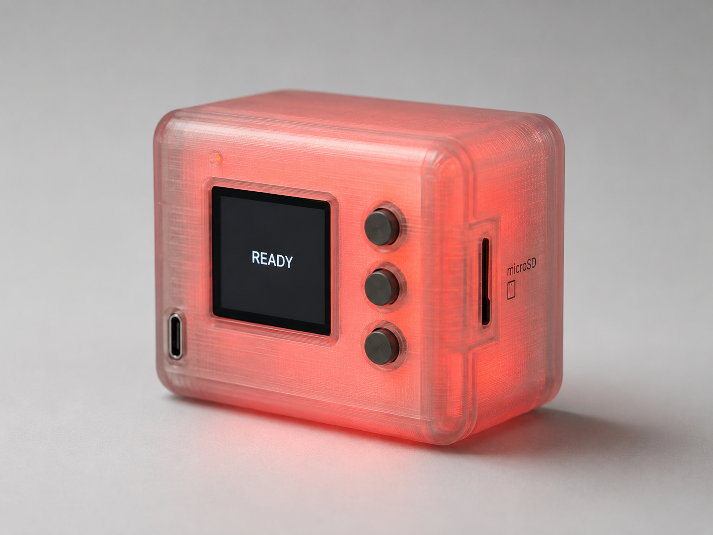

# Journal

## 2026-06-21, 18:08

Been thinking about this one for a while. Have too much on my plate atm and I
have to learn to prioritize work. Feels like it's one of those things that will
drift away and won't touch it for a while, but in the meantime I just wanted
some public record of it. It does have potential, but of course requires quite
a bit of time and even investment to get it going. So that's that.

For the record, here's another (early) idea of what this might look like. It
would be hard to achieve that glow, though?

