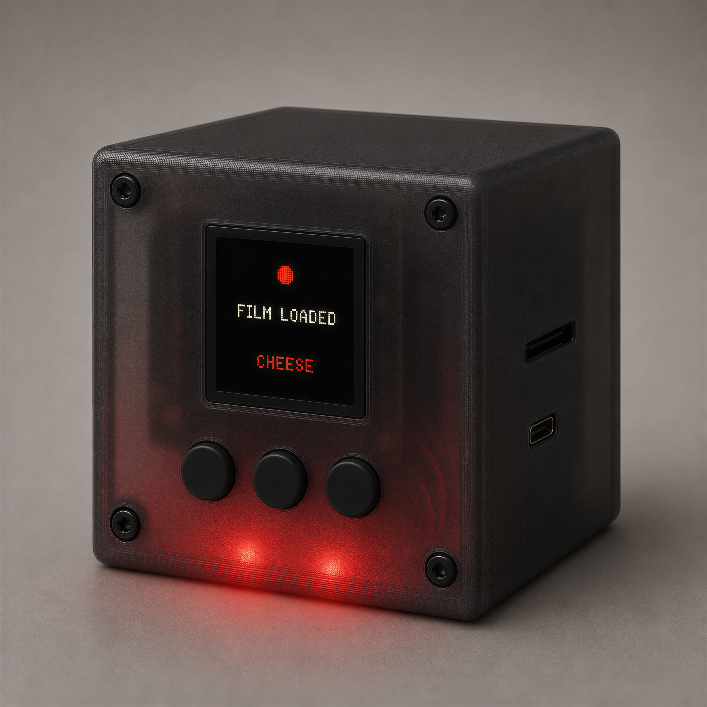
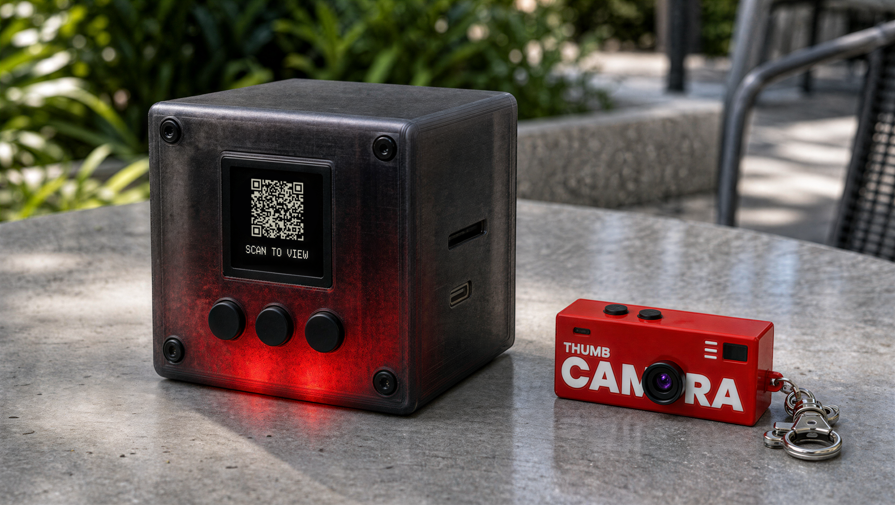

# The Darkroom

> **Very early idea.** The BOM is untested, and I most likely won't pursue this
> for now. Sharing it in case someone finds it interesting.

<p align="center">
  
</p>

Companion appliance to a keychain camera: slot in the camera's SD card and it
develops the photos through image generation, glowing red like a working
darkroom, with results appearing live in a gallery on your phone.

The idea comes from OpenAI's [imagegencam](https://github.com/openai/imagegencam),
a build-your-own AI camera. The Darkroom goes for the same result — photos
"developed" through image generation — but without building a camera from
scratch: if you already own a cheap keychain camera, you just hand its SD card
to the cube.

<p align="center">
  
</p>

- **[DARKROOM_BUILD_SPEC.md](DARKROOM_BUILD_SPEC.md)** — concept + build spec. Part 1 is load-bearing; read it first.
- **[BOM.md](BOM.md)** — parts list with purchase links and prices (local).

The whole app runs on a dev machine today with the hardware seams mocked:
screen and safelight are log lines, buttons are the keyboard, and any folder
(or a real card mounted by the OS) is the SD card. Pi backends come later;
nothing above the seams changes.

## Run it

```bash
python3 -m venv .venv && .venv/bin/pip install -r requirements.txt
.venv/bin/python scripts/make_fake_card.py            # builds sandbox/fakecard
.venv/bin/python -m darkroom --card sandbox/fakecard  # mock backend, no key needed
```

Open the gallery URL it prints (or scan the QR). Keys: `u`/`d` browse film
stocks, `s` load one, `i` re-insert the card, `q` quit.

- **Real card (macOS):** just `.venv/bin/python -m darkroom` — `/Volumes` is
  watched for anything with a `DCIM` folder. The card is never written to.
- **Real image generation:** `export OPENAI_API_KEY=...` then add
  `--backend openai`.

All knobs are documented in `config.example.toml`. Results land in `data/`.
