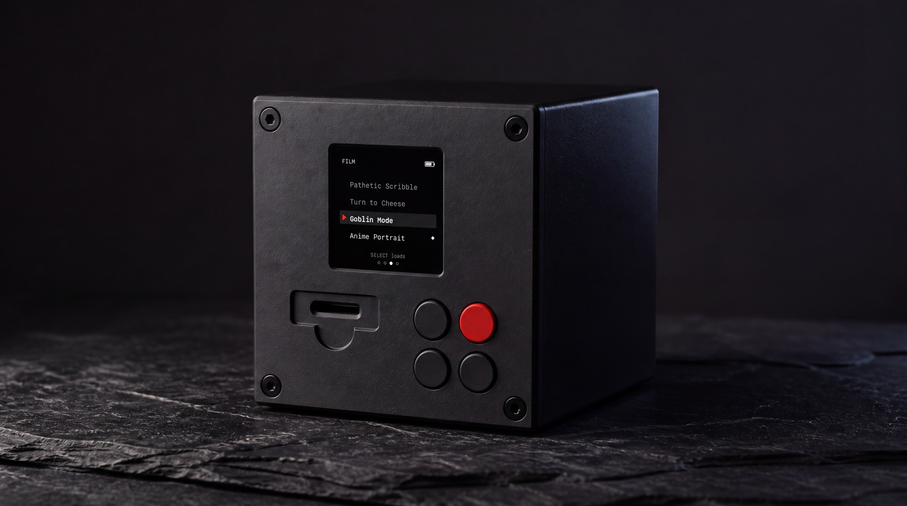
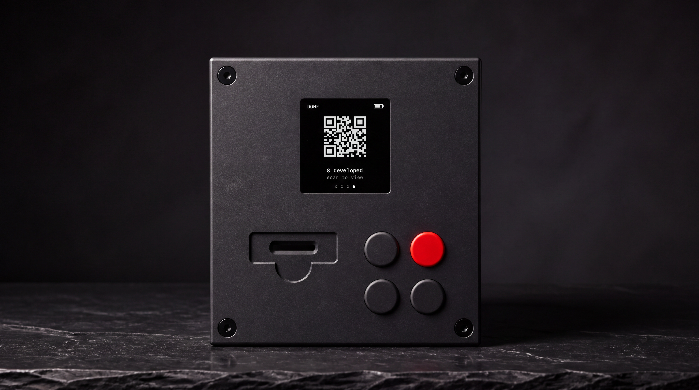

# The Darkroom

> **Very early idea.** The BOM is untested, and I most likely won't pursue this
> for now. Sharing it in case someone finds it interesting.

<p align="center">
  
</p>

Companion appliance to a keychain camera: slot in the camera's SD card and it
develops the photos through image generation, glowing red like a working
darkroom, with results appearing live in a gallery on your phone.

The idea comes from OpenAI's [imagegencam](https://github.com/openai/imagegencam),
a build-your-own AI camera that turns the photos it takes into generated images.

My first instinct was to turn my keychain camera into one of those, but the guts
gave me nothing to build on, and squeezing a Pi-class brain into that tiny shell
meant essentially rebuilding the camera anyway. So I flipped the question: rather 
than build a camera, what would a fun *companion* to one look like?

Keychain cameras are having a moment, and a small separate box that "develops"
whatever's on the card felt like a concept that could carry it.

<p align="center">
  
</p>

So the flow goes like this: you slot a camera's SD card into the cube, and it
runs each shot through the same kind of image generations; glowing red and
stepping through a developing sequence the way a darkroom works a print. 

When it's done, you scan the QR code on its screen and the developed photos 
show up in a web gallery on your phone. Download those there. Simple.

- **[DARKROOM_BUILD_SPEC.md](DARKROOM_BUILD_SPEC.md)** — concept + build spec. Part 1 is load-bearing; read it first.
- **[BOM.md](BOM.md)** — parts list with purchase links and prices (local).
- **[HARDWARE_PLAN.md](HARDWARE_PLAN.md)** — how it fits in the shell: cube sizing, component envelopes, and the main fit risk (the microSD slot).
- **[GEOMETRY.md](GEOMETRY.md)** — form-factor numbers; pairs with the parametric OpenSCAD model in [`cad/`](cad/). Renders: Codex image tool from the CAD with the brief in [`cad/renders/PROMPTS.md`](cad/renders/PROMPTS.md), re-resolved at 4K with Nano Banana Pro.

The whole app runs on a dev machine today with the hardware seams mocked:
screen and safelight are log lines, buttons are the keyboard, and any folder
(or a real card mounted by the OS) is the SD card. Pi backends come later;
nothing above the seams changes.

## Run it

```bash
python3 -m venv .venv && .venv/bin/pip install -r requirements.txt
.venv/bin/python scripts/make_fake_card.py            # builds sandbox/fakecard
.venv/bin/python -m darkroom --card sandbox/fakecard  # mock backend, no key needed
```

Open the gallery URL it prints (or scan the QR). Keys: `u`/`d` browse film
stocks, `s` load one, `i` re-insert the card, `q` quit.

- **Real card (macOS):** just `.venv/bin/python -m darkroom` — `/Volumes` is
  watched for anything with a `DCIM` folder. The card is never written to.
- **Real image generation:** `export OPENAI_API_KEY=...` then add
  `--backend openai`.

All knobs are documented in `config.example.toml`. Results land in `data/`.

## License

[MIT](LICENSE) © Jaime Ortega
